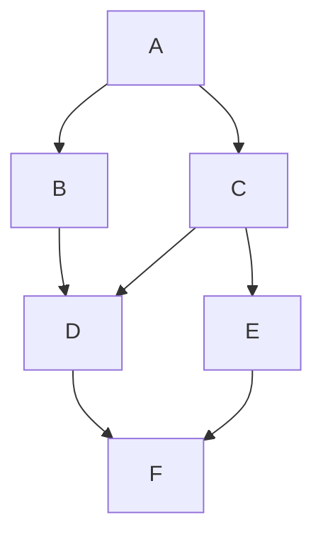

# cargo-dep-graph

CLI tool for visualizing Cargo dependency graphs.

The tool does **not** use package managers or third-party libraries to obtain
dependency information. `Cargo.toml` is fetched and parsed by the tool itself.

## Status

**Stage 5 — visualization.** Implemented:

- **Stage 1:** Loading and validation of a YAML configuration file, printing
  all user-configurable parameters as `key = value`, error handling.
- **Stage 2:** Fetching `Cargo.toml` from a GitHub repository URL or a local
  file, parsing TOML with a minimal in-repo parser, extracting direct
  dependencies from the `[dependencies]` section.
- **Stage 3:** Building a dependency graph with iterative DFS (no recursion),
  handling cycles via a visited set, limiting traversal depth (`max_depth`),
  filtering nodes by substring (`filter_substring`), and loading test graphs
  from a local file (`test_mode`).
- **Stage 4:** Printing reverse dependencies (packages that depend on the
  given package) by reversing the graph and reusing the same iterative DFS.
  Available in test mode via the `reverse` flag.
- **Stage 5:** Rendering the graph as a Mermaid flowchart or as an ASCII tree
  (controlled by the `ascii_tree` flag).
- **Extra:** Recursive dependency resolution via the crates.io API
  (`recursive: true`), with in-memory caching and resolution timing.

## Requirements

- Go 1.26+
- (optional) Nix, for reproducible builds
- (optional) `golangci-lint`, for linting

## Build

With Nix (recommended, pins Go 1.26 and `golangci-lint`):

```bash
nix develop
make build
```

Without Nix:

```bash
make build
```

The binary is written to `bin/cargo-dep-graph`.

## Run

```bash
./run.sh                 # uses config.yaml by default
./run.sh custom.yaml     # or an explicit config path
```

`run.sh` uses `nix develop` when Nix is available, and falls back to a local
Go toolchain otherwise.

## Test

```bash
make test
```

## Lint

```bash
make lint
```

## Configuration

All parameters are read from a YAML file (`config.yaml` by default).

| Parameter          | Type   | Description                                             |
| ------------------ | ------ | ------------------------------------------------------- |
| `package_name`     | string | Name of the Cargo package to analyze                    |
| `repository_url`   | string | Repository URL (used when `test_mode` is `false`)       |
| `test_mode`        | bool   | Read from `test_repo_path` instead of `repository_url`  |
| `test_repo_path`   | string | Path to a local test repository file                    |
| `ascii_tree`       | bool   | Render dependencies as an ASCII tree instead of Mermaid |
| `filter_substring` | string | Skip packages whose name contains this substring        |
| `max_depth`        | int    | Maximum analysis depth; 0 means "no limit"              |
| `reverse`          | bool   | Print reverse dependencies; requires `test_mode: true`  |
| `recursive`        | bool   | Recursively fetch dependencies from crates.io           |

Example:

```yaml
package_name: serde
repository_url: https://github.com/serde-rs/serde
test_mode: false
test_repo_path: ""
ascii_tree: false
filter_substring: ""
max_depth: 2
reverse: false
recursive: true
```

### Data Sources

The tool supports three data sources:

1.  **Direct (default).** If `test_mode: false` and `recursive: false`, the
    tool fetches a single `Cargo.toml` from `repository_url` and extracts its
    direct dependencies. GitHub URLs are normalized to
    `raw.githubusercontent.com` automatically.

2.  **Test repository.** If `test_mode: true`, the tool reads a test
    dependency graph from `test_repo_path`. Each line is `A B` (package A
    depends on package B). Empty lines and lines starting with `#` are
    ignored. Colons are treated as separators (`A: B` and `A:B` parse as
    `A B`), and package names are normalized to uppercase.

    Example test graph:

    ```text
    A B
    A C
    B D
    C D
    C E
    D F
    E F
    ```

3.  **Recursive (crates.io).** If `recursive: true`, the tool resolves the
    full dependency tree by querying the [crates.io API](https://crates.io).
    It fetches the latest version of each crate and its normal (runtime)
    dependencies, caching results in memory for the duration of the process.
    Use `max_depth` to limit the number of levels fetched.

    Note: crates.io imposes rate limits. If you hit `429 Too Many Requests`,
    reduce `max_depth` or wait a minute before retrying.

### Reverse dependencies

When `reverse: true` (test mode only), the tool prints packages that depend
on `package_name` instead of its dependencies. Reverse dependencies are
computed by building the full forward graph from the test repository,
reversing all edges, and running the same iterative DFS from `package_name`.

### Visualization

By default, the graph is rendered as a **Mermaid flowchart**:



Set `ascii_tree: true` to render the graph as an **ASCII tree** instead:

```
A
├── B
│   └── D
│       └── F
└── C
    ├── D
    │   └── F
    └── E
        └── F
```

If the graph contains cycles, the ASCII tree marks the repeated node with
`(cycle)` instead of expanding it indefinitely. Mermaid renders cycles as
bidirectional or repeated edges.

## Error handling

Every configuration parameter and every stage of the pipeline is validated.
Errors are reported with a context that shows where the failure occurred:

```
error: load config (config.yaml): configuration file not found: config.yaml
error: load config (config.yaml): package_name must not be empty
error: fetch manifest (https://github.com/user/repo): unexpected HTTP status: 404 for ...
error: parse manifest: toml: line 3: expected key = value
error: load test repo (graph.txt): test repo: line 5: expected 'A B', got "A B C"
error: resolve web-sys: registry: latest version of web-sys: response larger than 10485760 bytes
error: resolve serde: registry: latest version of serde: unexpected HTTP status 429
```

If a `Cargo.toml` has no `[dependencies]` section (for example, a workspace
manifest or a leaf package), the graph contains only the root node instead of
failing.

## Project layout

```
cmd/cargo-dep-graph/   CLI entry point
internal/cargo/        [dependencies] extraction
internal/config/       YAML loader, minimal parser, validation
internal/fetch/        Cargo.toml fetcher (HTTP + local files)
internal/graph/        Graph structure, iterative DFS, test repo loader,
                       reverse dependencies, recursive resolver
internal/registry/     crates.io API client with in-memory cache
internal/render/       Mermaid and ASCII tree renderers
internal/toml/         Minimal TOML parser
tests/fixtures/        Cargo.toml and test graph fixtures
```

## License

MIT
